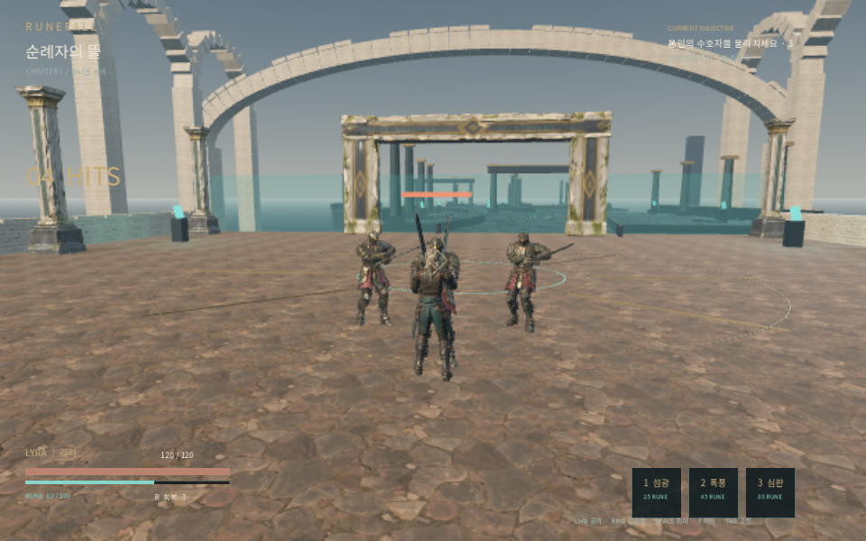

# RUNEFALL · 무너진 성역

Godot 4.7.2으로 제작하는 3인칭 판타지 액션 RPG입니다. 여성 룬 검사 **리라**가 몰락한 성역의 일곱 봉인을 정화합니다. 빠른 지상 콤보와 회피, 적중으로 충전하는 룬 스킬이 전투의 중심입니다.

**현재 버전: v0.1.4 캐릭터 프리뷰 프로토타입.** 챕터의 시작·전투·성장·보스·결말 흐름에 리라와 일반 근접 수호병의 실제 스킨 몸체를 적용했습니다. 이동·3연격·회피·패링·피격과 강공격·차지·스킬·사망·회복 표현을 게임 시간에 맞춰 저작했습니다. 첫 전투 구역의 기둥·문틀과 검도 VARCO 생성·Blender 후처리 자산입니다. 원거리·방패·정예·보스와 나머지 환경·음향은 기존 프로토타입이며 최종 아트 검수는 진행 중입니다. 목표 플레이 시간 30~60분과 RTX 3060급60fps는 아직 사용자 플레이테스트로 검증하지 않았습니다.

**최종 아트 목표는 AAA 품질입니다.** [대표 구간 승인 기준](docs/AAA_ART_QUALITY.md)에 얼굴·손·갑옷 변형·움직임·재질·조명과 실제 기기 성능의 검수 조건을 기록합니다. 현재 프리뷰는 이 최종 승인을 받지 않았습니다. 첫 전투 공간에는 출처와 물리적 반복 크기를 검증한 [CC0 PBR 재질](art_source/production/courtyard_materials/README.md)을 사용합니다.

[캐릭터 반입 기록](docs/CHARACTER_INTEGRATION.md)에 리라32k·수호병22k의 53본 리그, 프로젝트 저작 모션과 손·무기·접지 검증 범위를 기록합니다. runtime은 stock 클립을 복사하지 않은 리라19상태+RESET·수호병9상태+RESET을 사용합니다. 수호병의 이번 경량화·리깅·개발 샘플은0포인트이며 추가 구매는 없습니다. 이전1,250포인트 배치와 원본은 [기존 제작 기록](docs/ART_BATCH_2026_10_31.md)에 별도로 보존합니다. 최신 빌드·브라우저·배포 검사 상태는 [검증 결과](docs/VALIDATION.md)를 확인하세요.

**[웹에서 플레이하기](https://kosj.github.io/next-action-rpg/)** — PC 브라우저에서 키보드·마우스로 실행합니다.



## 실행

1. **Godot 4.7.2 Standard**에서 `game/project.godot`을 엽니다. .NET 버전은 필요하지 않습니다.
2. 에셋 불러오기가 끝나면 **F5**로 전체 게임을 실행합니다.
3. 타이틀에서 새로운 서약을 시작하거나 저장한 여정을 이어갑니다.

Blender가 없어도 게임을 실행할 수 있습니다. 반입한 GLB 파일이 저장소에 포함되어 있습니다. Blender 원본을 편집하려면 Git LFS를 설치한 뒤 `git lfs pull`을 실행하고 **Blender 4.3.2**를 사용합니다.

## 조작

| 동작 | 키보드·마우스 | Xbox 계열 패드 |
|---|---|---|
| 이동 / 시점 | WASD / 마우스 | 왼쪽 / 오른쪽 스틱 |
| 달리기 | Shift | LS 누르기 |
| 연속 공격 / 강공격 | 좌클릭 / 우클릭 | X / Y |
| 차지 강공격 | 우클릭을 길게 눌렀다가 놓기 | Y를 길게 눌렀다가 놓기 |
| 회피 / 패링 | Space / F | A / LB |
| 대상 고정 / 다른 대상 | Tab / Q | RS / RB |
| 스킬 3종 | 1 / 2 / 3 | 방향키 ← / → / ↓ |
| 회복 / 상호작용 | R / E | 방향키 ↑ / B |
| 일시정지 / 성능 표시 | Esc / F3 | Start / — |

공격 후 회복 구간에 다음 공격을 입력하면 콤보가 이어집니다. 방패형 적은 강공격으로 무너뜨리세요. 적의 공격 전 빛나는 표식은 패링 타이밍의 단서입니다. 보스의 원형 충격파는 회피해야 합니다. 시작 거점과 길 위의 수정에서 휴식하고 강화할 수 있습니다.

## 빌드와 테스트

엔진과 동일한 **4.7.2 export templates**를 설치합니다. Linux 자동 설치는 `bash tools/setup_godot.sh`를 사용할 수 있습니다. 스크립트가 출력하는 `GODOT_BIN`, `XDG_DATA_HOME`을 환경 변수로 설정합니다.

```bash
python tools/build.py --test-only
python tools/build.py
python tools/build.py --windows
python -m http.server 8060 --directory build/web
```

브라우저에서 `http://localhost:8060`으로 접속합니다. HTML 파일을 직접 열면 실행되지 않습니다. 산출물은 `build/runefall-web.zip`, `build/runefall-windows.zip`이며, 파일 크기와 SHA-256은 `build/manifest.json`에 기록됩니다. Windows ZIP은 압축을 푼 후 EXE와 PCK를 같은 폴더에 두고 실행합니다.

Python 3.10 이상을 사용합니다. `python -m pip install -r tools/requirements-dev.txt`로 검증 도구를 설치합니다. Playwright와 Chromium이 있으면 `python tools/browser_smoke.py http://127.0.0.1:8060`으로 실제 웹 실행과 화면 캡처를 검증할 수 있습니다. `python tools/check_web.py`는 하위 URL에서 서빙해 검사하며 브라우저 종료·재시작 후 저장 복원까지 확인합니다. `CHROMIUM_PATH`로 브라우저 경로를 지정합니다.

## 저장과 배포

저장은 Godot의 `user://runefall_v1.json`에 기록됩니다. 체크포인트·강화·전투 완료 시 저장하고 이전 파일을 백업합니다. 웹 저장은 해당 브라우저와 배포 주소에 종속되며 브라우저 데이터 삭제 시 사라질 수 있습니다. Windows와 자동 동기화하지 않습니다.

GitHub Actions는 PR과 main 변경에서 회귀 검사와 웹 ZIP을 만들며, 태그 또는 수동 실행에서 Windows ZIP도 생성합니다. **Actions → 실행 결과 → Artifacts**에서 다운로드합니다. 버전 태그의 빌드는 [GitHub Releases](https://github.com/kosj/next-action-rpg/releases)에도 자동 첨부합니다. main의 성공 빌드는 **GitHub Pages**로 배포합니다. 저장소 Settings → Pages에서 Source를 **GitHub Actions**로 활성화해야 합니다. [배포 안내](docs/DEPLOYMENT.md)를 참고하세요.

## 제작 문서

- [반복 작업 스킬과 지식 DB](knowledge/README.md) · [작업 시작 규칙](AGENTS.md)
- [최신 자료·공개 스킬에 따른 재검증 근거](docs/ENGINEERING_EVIDENCE.md)
- [설계와 현재 구현 상태](docs/DESIGN.md)
- [Blender·VARCO 아트 제작 가이드](docs/ART_PIPELINE.md)
- [대표 구간 제작 명세·참조 이미지·검수 기준](docs/ART_SLICE.md)
- [AAA 최종 아트 승인 기준](docs/AAA_ART_QUALITY.md)
- [VARCO 공식 MCP 연결과 검증 절차](docs/VARCO_MCP.md)
- [웹·Windows 배포 안내](docs/DEPLOYMENT.md)
- [검증 결과와 남은 작업](docs/VALIDATION.md)
- [외부 구성 요소와 라이선스](THIRD_PARTY_NOTICES.md)

사용자가 2026-10-30 저장소를 공개로 전환하고 Pages Source를 GitHub Actions로 활성화했습니다. 웹 빌드는 [GitHub Pages](https://kosj.github.io/next-action-rpg/)에 게시되어 있으며 main의 성공 빌드가 자동 배포됩니다. 실제 배포 근거는 [배포 안내](docs/DEPLOYMENT.md)를 확인하세요.
