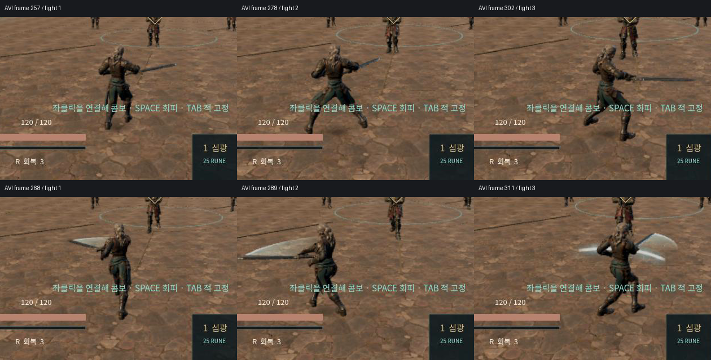
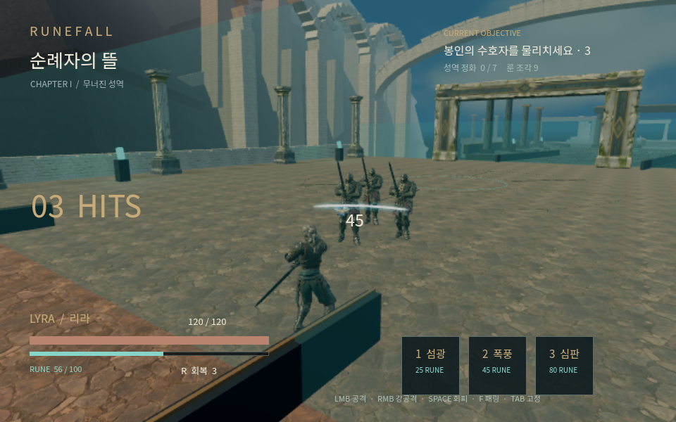

# v0.1.16 이동 공격·전진 검기 검증

[제작 근거](../../LOCOMOTION_WAVE_SLICE.md) · [기능 검사와 기각 이력](native-and-first-visual.json) · [실제 Game 결과](actual-game-final.json) · [현재 source 고정](runtime-source-freeze.json)

실제 Player 입력·충돌 후 변위·벽·상하체 layer·검기 sweep/ledger·타이틀/체크포인트 복귀를 포함한 local native는 **843검사/0실패·ERROR0**이다. source006의 입력 고정과 이후 test-only 관측기 guard·GLSL 이식성 수정을 구분했다.

실제 main Game에서 보통 입력으로 UI를 거쳐 900 gameplay tick을 촬영했다. logical1x/60Hz 원본은 UI·정리를 포함해 928 frame/15.467초이며 엔진 PCM을 포함한다. exit0·ERROR0·촬영 중 source 변경0이다. 요청 이동량 대신 매 tick 실제 수평 변위를 snapshot과 대조한 차이는 부동소수 계산 수준(최대6.6e-9m)이었다. 이 수치는 발 접지나 자연스러운 애니메이션 승인이 아니다.

[정상 속도 영상 MP4](media/moving-combat.mp4)는 원본 MJPEG+PCM을 H.264/AAC로 변환한 전달본이다. 프레임 보간·추가 타격음·연출 편집을 하지 않았다. 논리 1배속 인코딩과 사람이 전체를 연속 시청/청취했다는 주장을 구분한다. 원본·전달본 해시와 범위는 결과 JSON에 있다.

실제 차지 검기는 발사 원점에서 node 중심까지 수평거리 **5.335m·5.800m·7.009m**인 세 적에게 각45.045를 적용했고 첫 적을 처치했다. 이 거리는 hurtbox 표면까지의 거리가 아니다. 모든 실제 receipt의 같은 attack/target 쌍은 최대1개다. 전체 take에서 검기 명중은6개이며 근접·검기 ledger를 공유한다. 별도 물리 회귀는 표시 hull과7.5m source-leading 한계·벽의 최초 차단·초기 overlap·큰delta를 검사했다.

루트와 독립 검토자는 유한 원본에서 달라지는 하체 자세와 에너지 방출·명중을 보고 **프로토타입 개선 방향만 채택**했다. 근거리 검기의 수평 흰 띠 같은 모양, 넓은 보폭·회수/허리 연결·terrain 접지·전체 skin은 남는다. 연속1배속 직접 시청·직접 청취·목표 기기FPS·AAA 품질은 미승인이다. 이 source 기록 시점의 clean Web/모바일·공개 배포/릴리스 결과는 별도 전달 원장 대상이다.

첫 cyan 판, EMISSION-only unshaded 미표시, 해제된 적을 읽던 촬영 관측기와540px no-stretch 촬영 UI 실패를 보존했다. 이들을 성공 take로 바꾸지 않았다. 현재 shader는 ALBEDO에 색을 전달하고 음수 밑 pow 대신 세 곳의 제곱을 곱셈으로 계산한다. 수정 전후 기술용 실제 raster의 PNG SHA는 같았으며 정상 Game 전체 source byte 동일 주장과 구분한다.
